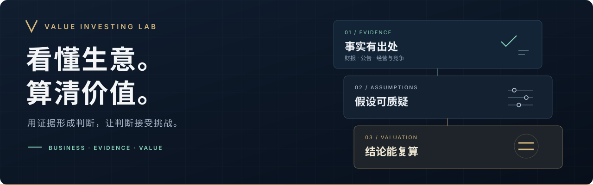

<div align="center">



# 价值投资实验室

**一家公司，一篇主报告，一套可以被挑战的判断。**

用公开信息理解企业，将经营判断推导为盈利、现金与价值。<br>
AI 辅助研究，证据支持结论，反证推动修正。

[**阅读研究 ↓**](#公司研究)　 /　 [**使用方法 ↓**](#开始一份研究)　 /　 [**提出挑战 ↗**](https://github.com/ruanzh6/value-investing-lab/issues/new/choose)

</div>

---

## 公司研究

从最重要的问题开始阅读，沿主报告进入证据和计算。

| 公司 | 这份研究要回答什么 | 阅读与复核 |
| :--- | :--- | :--- |
| **宁德时代**<br>动力电池 · 储能<br><sub>300750 / 03750 · 2026-11-07</sub> | 规模领先之后，增长能留下多少股东现金？ | [**主报告 →**](reports/300750-宁德时代/README.md)<br>[事实与证据](reports/300750-宁德时代/evidence/README.md) · [估值计算](reports/300750-宁德时代/valuation/README.md) |
| **古井贡酒**<br>白酒 · 消费<br><sub>000596 / 200596 · 2026-11-07</sub> | 收入恢复之后，渠道利润与资本效率能否跟上？ | [**主报告 →**](reports/000596-古井贡酒/README.md)<br>[事实与证据](reports/000596-古井贡酒/evidence/README.md) · [估值计算](reports/000596-古井贡酒/valuation/README.md) |

<sub>日期为研究基准日，报告不随行情自动更新。旧版研究已清理，历史版本可通过 Git 追溯。</sub>

## 一份判断，三层依据

| 01 · 看懂生意 | 02 · 算清价值 | 03 · 接受挑战 |
| :--- | :--- | :--- |
| 谁付钱，为什么选它？<br>优势能持续多久，增长需要多少投入？ | 利润能否成为股东现金？<br>从经营假设推导未来价值与买入条件。 | 最强反方解释是什么？<br>哪些证据出现后，必须改变判断？ |

**方法分工**：[`value-investing`](skills/value-investing/SKILL.md) 提供投资理念与[量化原则](skills/value-investing/references/quantitative-principles.md)；[`deep-valuation`](skills/deep-valuation/SKILL.md) 指导研究、取证、反向挑战和报告产出。

三年后价值、今天的价格与合理买入点分别表达。正文给出一个概率加权主预测，假设、情景和敏感性放入附录，让读者能审阅推导，而不只看到一个数字。

## 开始一份研究

在能够读取本仓库文件的 Agent 中，将「公司名」替换为研究对象，使用以下提示词：

```text
按照 deep-valuation skill 的准则完成对「公司名」的评估，需要保证 value-investing skill 中的准则都已经深刻执行，且市场公开信息已充分利用。
```

研究结果保存在 `reports/<代码>-<中文公司名>/`，保留唯一主报告及必要附录。具体约定见[产出结构](skills/deep-valuation/references/output-structure.md)。

<details>
<summary><strong>查看报告目录与材料约定</strong></summary>

```text
reports/<代码>-<中文公司名>/
├── README.md          唯一主报告：判断、推导、反方与更新条件
├── evidence/
│   ├── README.md      来源索引、证据与缺口
│   └── raw/           实际取得的原始材料
└── valuation/
    ├── README.md      假设、公式、敏感性与适用范围
    └── …              必要输入、计算脚本和结果
```

固定三个 `README.md` 入口，正文围绕公司的关键问题组织，不套固定章节。专题证据与计算文件按需增加，缺少原件时明确说明，不创建空白占位，也不以摘要冒充原件。

事实、计算和预测分开写；来源可追溯、数字可复算。旧版本由 Git 保存，不并列维护摘要、结论卡或多份报告。历史审阅意见不等于对现行全部参数的独立认可。

</details>

## 欢迎挑战结论

数据有误、假设站不住，或出现了足以推翻判断的新证据，都值得讨论。

**[提交 Issue →](https://github.com/ruanzh6/value-investing-lab/issues/new/choose)** 请附公司代码、仓库内文件路径和可复核的证据链接。讨论聚焦事实、口径、计算与证伪条件；只问「现在能不能买 / 要不要卖」的 Issue 不受理。

内容改动通过 Pull Request 提交，写明修改对象及证据。不要提交未披露的内部数据、个人持仓、密钥或未经审阅的草稿。完整规则见 [AGENTS.md](AGENTS.md)。

---

**研究边界**　研究由 AI 辅助完成，来源不足和未解问题在报告中披露。现价、合理价与合理买入点均为研究用数字，不是买卖指令；报告未给出估值或写明买点未启用时，以该结论为准。本仓库不提供交易服务，不代客下单。

<div align="center">

[更新记录](CHANGELOG.md)　 ·　 [理念文章 · 待补](philosophy/README.md)　 ·　 [MIT License](LICENSE)

<sub>保持好奇，尊重事实，允许自己改变判断。</sub>

</div>
